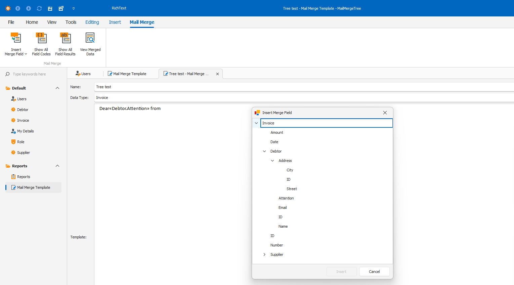

# MailMergeTree

A hierarchical field picker for the XAF Office Module mail merge template editor (WinForms).

Out of the box, **Insert Merge Field** shows a flat list of the Data Type's top-level properties. Nested values such as
`Debtor.Attention` have to be typed by hand through *Show All Field Codes*. This sample replaces the flat list with a
tree: the template's Data Type is the root, reference properties expand lazily over any number of levels, captions come
from the Application Model, and the chosen path is inserted as a `MERGEFIELD` at the caret.

View Merged Data resolves the inserted subfields (here `Debtor.Attention` and `Debtor.Address.City`):

## What is in here

| Path | What |
| --- | --- |
| `MailMergeTree/MailMergeTree.Win/Controllers/MailMergeFieldTreeController.cs` | Hooks both halves of the ribbon button and inserts the field |
| `MailMergeTree/MailMergeTree.Win/Controllers/MergeFieldTreeForm.cs` | The tree dialog, built from XAF's own Object Model parts |
| `MailMergeTree/MailMergeTree.Module/BusinessObjects/DemoObjects.cs` | Demo model: Invoice -> Debtor -> Address, Supplier |
| [docs/how-to-implement.md](docs/how-to-implement.md) | Step by step: add this to your own XAF WinForms app |
| [docs/findings.md](docs/findings.md) | What DevExpress offers, which extension points exist, what the spike does not cover |

Stack: XAF 26.1, WinForms, EF Core, Middle Tier security, .NET 10. The picker itself only uses XAF type info and the
`RichEditControl`, so it is the same for XPO.

## Run it

Needs DevExpress 26.1 (NuGet feed configured) and SQL Server LocalDB. Build once:

    dotnet build C:\Projects\MailMergeTree\MailMergeTree.slnx

Then, in PowerShell (no admin), one line each, middle tier first. The LocalDB database `MailMergeTree` is created and
seeded on first start.

    Start-Process "C:\Projects\MailMergeTree\MailMergeTree\MailMergeTree.MiddleTier\bin\Debug\net10.0\MailMergeTree.MiddleTier.exe" -WorkingDirectory "C:\Projects\MailMergeTree\MailMergeTree\MailMergeTree.MiddleTier"
    Start-Process "C:\Projects\MailMergeTree\MailMergeTree\MailMergeTree.Win\bin\Debug\net10.0-windows\MailMergeTree.Win.exe"

Log in as `Admin` (empty password), open **Reports > Mail Merge Template**, create a template with Data Type
**Invoice**, click into the editor and press **Insert Merge Field**. Double-click a field, or select it and press
**Insert**. One invoice (`INV-001`) with a debtor, address and supplier is seeded, so **View Merged Data** shows values.

## Limits

- The tree lists members from type info; member-level read permissions are not applied to it.
- In Bars menu mode (no ribbon) the drop-down arrow keeps the flat list; the button itself opens the tree.
- `ModelBrowserAdapter` and `ObjectTreeList` are public but undocumented DevExpress classes and can change between versions.
- Verified with the tabbed MDI UI and the default skin only.
